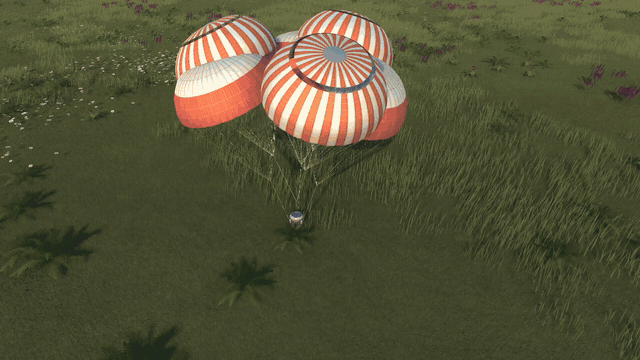

# ChuteFX

Parachute cloth effects for Kerbal Space Program 1.12.



ChuteFX makes stock parachutes look like fabric. Open canopies flutter and breathe in the airflow. A canopy that has
been cut, either by you or by the automatic cut after landing, is not just deleted: it becomes a simulated piece of
cloth that drifts down, drapes over the ground or floats on the water, and soaks up water and sinks.

ChuteFX is purely visual. It does not touch the physics or the drag of the parachutes.

## Installation

1. Install [ModuleManager](https://github.com/sarbian/ModuleManager). It adds the right-click entries.
2. Download `ChuteFX-x.y.z.zip` from the [releases](https://github.com/kiaulens/ChuteFX/releases).
3. Copy the `GameData/ChuteFX` folder into the `GameData` folder of your KSP installation.

## Compatibility

- KSP 1.12.x. Made and tested on 1.12.5.
- Works with the stock parachutes (`ModuleParachute`) and with the ReStock parachute models. Other part packs that
  use `ModuleParachute` should work as long as their canopy is a regular or skinned mesh.
- RealChute is not supported: it does not use `ModuleParachute`.
- [Parallax Continued](https://github.com/Gameslinx/Parallax-Continued): ChuteFX reads the Parallax terrain
  displacement and lifts the cloth on land by that amount, so it doesn't sink into the tessellated ground. Grass and
  other Parallax scatters still poke through the cloth.
- Mods that only change the look of the world (Scatterer, EVE, TUFX, Deferred, ...) are fine.

## Features

**Open canopy**
- The canopy flutters (mostly along the hem), breathes and leans into sideways airflow. The lines stay straight.
- At touchdown the canopy keeps its orientation from the flight, so stock's sudden swing on landing goes away.
- The effect only runs at full rate within 300 m, and every 3rd frame up to 1 km.

**Cut canopy**
- A copy of the canopy is simulated as cloth (position-based dynamics, fixed 40 Hz step). Stretch is hard,
  compression and bending are soft in the air and stiffer on the ground, so the cloth lies in large folds.
- Shroud lines become rope chains that start where the original lines end at the hem and run to the real line knot,
  with a riser to the part. After a landed cut the riser stays attached to the part. The ropes take their colour from
  the original line texture, including a dark edge if the original lines have one (stock Mk16).
- Air: sail force normal to the cloth, a short residual pressure that keeps the canopy inflated for a moment after
  the cut, turbulence, and a shared wind per celestial body that slowly changes strength and direction with game
  time, so all canopies blow the same way.
- Ground: the height under every cloth point comes from raycasts. Cloth layers stack: folds of one canopy and
  different canopies do not pass through each other, and the canopy that landed later lies on top. Several canopies
  of one vessel spread out around it.
- Water: buoyancy and waves. The canopy keeps its colour for a moment, then darkens as it soaks up water, floats
  for a while and sinks. In shallow water it comes to rest on the seabed.
- A canopy at rest costs nothing. It sinks into the ground after 10 minutes of game time (time warp counts).
- Multi-canopy parts such as the ReStock Mk16-XL work: each cap is a canopy of its own, with its own lines.

**Visibility and cleanup**
- A cut canopy under the mouse cursor turns semi-transparent, so you can see what you are about to click. The same
  happens when it hides a Kerbal on EVA from the camera.
- The right-click menu of a parachute part gets **Remove canopy** and **Remove all canopies**. They only appear
  while a cut canopy is lying around. Repacking the parachute on EVA removes its canopy as well.
- Menu texts are translated into English, German, Spanish, French, Italian, Brazilian Portuguese, Russian, Japanese
  and Simplified Chinese.

## Settings

All settings are in `GameData/ChuteFX/Settings.cfg` and are read when the game starts. Each one is commented. The
ones you are most likely to change:

| Setting | Default | Meaning |
|---------|---------|---------|
| `flightEffects` | `true` | Flutter of the open canopy. `false` leaves the open canopy as stock draws it. |
| `groundLifetime` | `600` | Seconds of game time a canopy stays before it sinks into the ground. `0` keeps it until the scene changes. |
| `maxFallen` | `30` | Most cut canopies lying around at the same time. |
| `maxDistance` | `5000` | Canopies farther than this (m) from the active vessel are removed. |
| `fadeOnHover`, `fadeForKerbals`, `fadeAlpha` | `true`, `true`, `0.55` | Transparency under the cursor and in front of Kerbals. |
| `windSpeed` | `3` | Wind for cut canopies (m/s). |
| `lineColorAuto` | `true` | The ropes take the colour of the original lines. `false` uses the grey `lineGray`. |
| `layerThickness` | `0.05` | Distance between cloth layers on the ground. `0` turns layering off. |
| `clusterSpread` | `false` | Open canopies of one vessel tilt apart instead of passing through each other. Off by default, because the cluster keeps rearranging when SAS corrects or the capsule rolls. |
| `debugLog` | `true` | Messages tagged `[ChuteFX]` in `KSP.log`. |

## Performance

Only falling and settling canopies are simulated. A canopy at rest is not simulated any more and costs nothing.
The layer pass only runs while a canopy is still moving. With three canopies falling and settling at once, a slight
stutter is possible.

## Known limitations

- There is no self-collision in the air. Crumpled cloth, mostly on the small drogues, can pass through itself in
  places, and canopies that touch in the air can interpenetrate.
- Grass and other terrain scatters show through canopies lying on the ground.

## Building

The plugin is a single C# 5 file built with the .NET Framework compiler that ships with Windows. Visual Studio is not
needed.

```powershell
./build.ps1 -KspPath "C:\Path\To\Kerbal Space Program"            # builds GameData/ChuteFX/Plugins/ChuteFX.dll
./build.ps1 -KspPath "C:\Path\To\Kerbal Space Program" -Deploy    # ... and copies GameData/ChuteFX into KSP
./build.ps1 -KspPath "C:\Path\To\Kerbal Space Program" -Package   # ... and creates the release zip
```

Instead of `-KspPath` you can set the environment variable `KSP_PATH`. KSP locks the DLL while it is running, so close
the game before deploying.

## Tests

`Tests/` contains offline tests that run the real ChuteFX code in the Unity editor without KSP: piece analysis of
multi-cap canopies, render normals, cluster samples, and a 30 s ground and water simulation that renders images. See
[Tests/README.md](Tests/README.md).

## License

[MIT](LICENSE)
